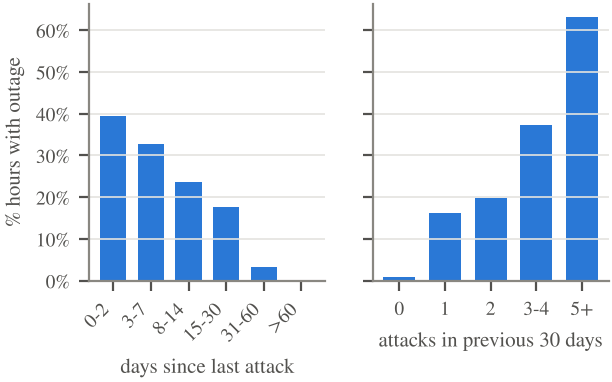
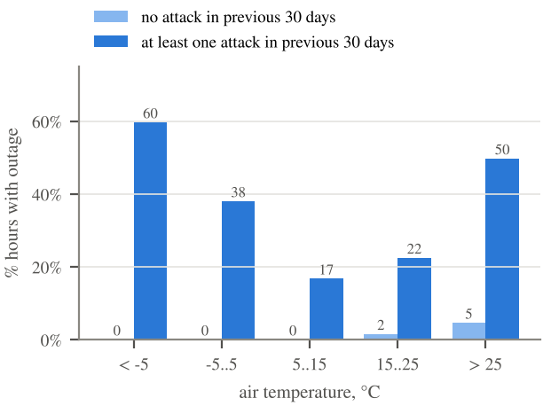
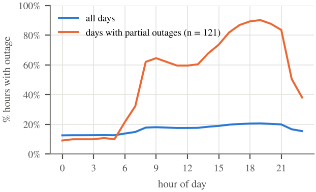
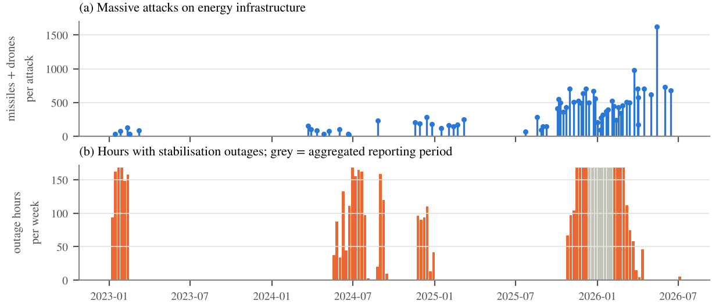
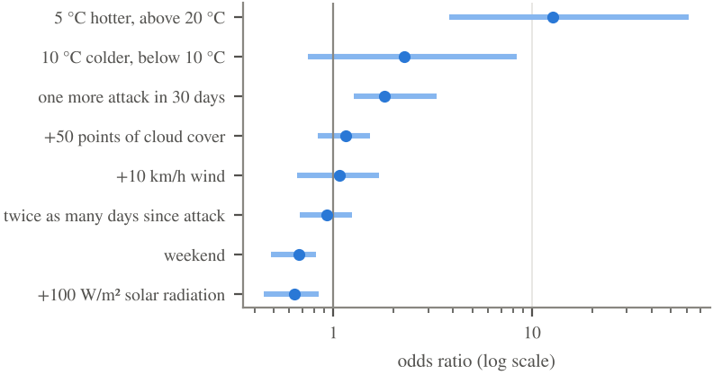
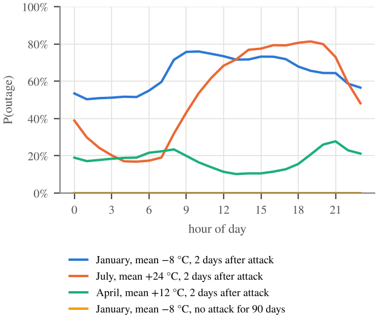

# Missile Strikes, Weather and Rolling Blackouts in Ukraine

A data analysis of **when and why nationwide planned power outages are applied in Ukraine**, based on 30,644 hours of open data from January 2023 to June 2026.

📄 **Paper:** [paper/paper.pdf](paper/paper.pdf)  
📓 **Notebooks:** [data cleaning & EDA](notebooks/01_data_cleaning_eda.ipynb) · [hypothesis tests & model](notebooks/02_hypothesis_tests_model.ipynb)

---

## Key findings

**1. A recent massive attack is a precondition for outages.** Without a massive strike on energy infrastructure in the previous 30 days, nationwide outages occurred on only 2% of days. After attacks, they occurred on 37% of days. No outage occurred later than 60 days after an attack.



**2. But it is not a sufficient condition.** In Q1 and Q3 2025 there were five massive attacks per quarter and zero outage hours. In Q2 2026 there were eight attacks, the most powerful of the whole period, and outages covered only 2.5% of hours.

**3. Weather amplifies outages but does not decide them.** After attacks, outages covered 60% of hours below −5 °C, 50% of hours above 25 °C and only 17% of hours between 5 and 15 °C. Without attacks, the share stayed below 5% at any temperature.



These shares are averages over opposite seasons. The same weather after attacks led to very different outcomes:

| Days after attacks | Quarter | Days | Hours with outages |
|---|---|---|---|
| Cold, mean below 0 °C | Q1 2023 | 39 | 67% |
| | Q4 2024 | 19 | 52% |
| | Q1 2025 | 33 | 0% |
| | Q1 2026 | 25 | 100% |
| Hot, mean above 22 °C | Q2–Q3 2024 | 36 | about 90% |
| | Q3 2025 | 15 | 0% |
| | Q2 2026 | 15 | 1% |

What decides is the state of the power system after each series of attacks: what was damaged, how fast it was repaired, how much could be imported. Open data do not describe it.

**4. Most outage hours fall on round-the-clock days.** Of the 264 days with outages, 143 were round-the-clock days, and they contain 70% of all outage hours. The daily pattern is visible on the 121 days with partial outages: about 10% of hours at night and 82–90% in the evening peak from 16:00 to 21:00.



**5. Solar radiation is associated with lower risk.** After controlling for temperature and attacks, 100 W/m² more radiation multiply the odds of an outage by 0.64, with a 95% interval of 0.45–0.84. When radiation is measured against its norm for the month and hour, the effect is weaker: 0.83, interval 0.72–0.95. This is consistent with a contribution of distributed solar generation, but it is not a proof, because the output of solar plants is not observed.

## Timeline



## Model

The task is to estimate the probability that nationwide outages are applied in a given hour from hour of day, weekday, weather and the history of attacks.

| Model | ROC AUC, unseen 2025/26 season | Mean ROC AUC, leave-one-wave-out | Brier score, 2025/26 |
|---|---|---|---|
| Baseline: attack history only, 3 features | 0.81 | 0.83 | 0.193 |
| Logistic regression with weather × attack interactions | 0.83 | **0.86** | **0.174** |
| Gradient boosting | **0.86** | 0.83 | 0.263 |

Logistic regression is the main model: it ranks hours by risk best on average and is easy to interpret.

**What the model cannot do.** Its absolute probabilities do not transfer between seasons. On the 2025/26 season the mean predicted risk, 36%, is close to the observed 39%, but only because errors cancel out: 37% predicted against 87% observed in November 2025, 33% against 7% in April 2026. In two of the four validation waves its Brier score is worse than the base rate. The model is suited to comparing conditions and hours with each other, not to forecasting the level of outages in a new season.

Odds ratios after recent attacks, in natural units, with 95% block-bootstrap intervals:



## How the risk is distributed over the day

The scenarios show the predicted probability that nationwide outages are applied in a given hour. This is not the probability that a particular consumer is disconnected: outages rotate between queues. The shape of the curves is more reliable than their level.



## Data

| Source | Content | Step | Used in |
|---|---|---|---|
| [Energy Map](https://energy-map.info), DiXi Group | Nationwide stabilisation outages applied by NPC Ukrenergo | hour | paper, notebooks |
| [Energy Map](https://energy-map.info), DiXi Group | Massive strikes on critical infrastructure | event | paper, notebooks |
| [Open-Meteo](https://open-meteo.com) Historical Weather API | Temperature, cloud cover, solar radiation, wind for Kyiv | hour | paper, notebooks |
| [Energy Map](https://energy-map.info), DiXi Group | Electricity import and export by country | hour | context charts in notebook 01 |

Raw data are **not included** in this repository. See [data/README.md](data/README.md) for download instructions.

## Repository structure

```
├── notebooks/
│   ├── 01_data_cleaning_eda.ipynb       # cleaning, merging, exploratory analysis
│   └── 02_hypothesis_tests_model.ipynb  # statistical tests, models, scenarios
├── data/
│   ├── raw/        # put downloaded CSV files here (not tracked by git)
│   └── clean/      # hourly_dataset.csv is created by notebook 01 (not tracked)
├── figures/        # figures produced by the notebooks
├── paper/
│   ├── paper.pdf   # the paper
│   ├── paper.tex   # LaTeX source
│   ├── analysis.py # reproduces all figures and numbers of the paper
│   └── figures/
└── docs/img/       # figures used in this README
```


## How to reproduce

```bash
git clone https://github.com/dkrainii/ukraine-power-outages-analysis.git
cd ukraine-power-outages-analysis
pip install -r requirements.txt
```

1. Download the four datasets into `data/raw/` as described in [data/README.md](data/README.md).
2. Run `notebooks/01_data_cleaning_eda.ipynb`. It creates `data/clean/hourly_dataset.csv`.
3. Run `notebooks/02_hypothesis_tests_model.ipynb`.
4. Optionally, run `python analysis.py` inside `paper/` to rebuild the paper figures and `numbers.json` with every number quoted in the paper.

## Limitations

- Only large-scale outages and officially declared massive strikes are included; local events are not. The strike register gives no time of day.
- Round-the-clock days contain 70% of outage hours, so the hourly target mostly reflects differences between days and seasons, and the number of independent episodes is small.
- Weather in Kyiv is used as a proxy for the whole country, and it is observed weather, not a forecast.
- The state of repairs, import capacity and fuel stocks is not available as open hourly data. These factors probably explain why the same attacks and weather led to outages in one season and not in another.
- Hourly and daily observations are autocorrelated, so p-values and bootstrap intervals are indicative.

## Author

**Danylo Krainii**, independent researcher, student at Lviv Polytechnic National University, Lviv, Ukraine.

## License

Code is released under the [MIT License](LICENSE). Data belong to their original providers: Energy Map by DiXi Group and Open-Meteo, the latter under CC BY 4.0.
